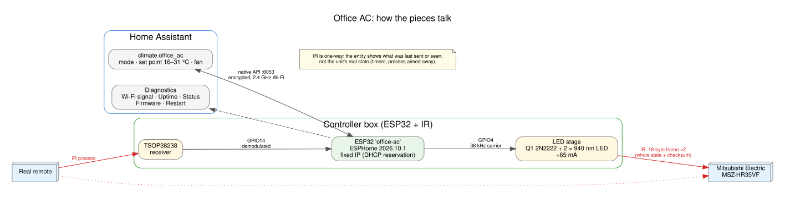

# Office AC automation: ESP32 + IR for a Mitsubishi MSZ-HR35VF

An ESP32 with an IR LED and an IR receiver, running **ESPHome**. Home Assistant
discovers it as a device called **Office AC** with a thermostat (climate)
entity, diagnostics and a restart button. It replaces the remote over IR, and
the receiver picks up presses on the real remote so Home Assistant's idea of
the state stays closer to reality.

For parts, wiring and the step-by-step build, see `final-build-guide.md`.
Diagrams (schematic, wiring, system, build status, perfboard layout) are in `docs/diagrams/`.



```
aircon-ir/
  esphome/office-ac.yaml          the firmware (ESPHome config)  <- main path
  esphome/secrets.yaml.example    Wi-Fi + API key template
  homeassistant/office_ac.yaml    optional example automation package
  final-build-guide.md            parts, wiring, build order
  docs/diagrams/                  schematic, wiring, system, build-status, perfboard (SVG + PNG)
  tools/diagrams.py               regenerates docs/diagrams (Schemdraw + Graphviz)
  tools/perfboard.py              perfboard layout data + netlist check (used by diagrams.py)
  tools/analyse_ir.py             record / decode / diff / forge raw captures
  examples/                       sample captures from library encoders (not a real unit)
  platformio.ini, src/, include/  fallback only: PlatformIO capture + HTTP controller
  tools/host_check.sh, tools/host/  tests for the fallback firmware
```

## How it fits together

```
 Home Assistant  <== native API (encrypted, port 6053) ==>  ESP32 (ESPHome)
   "Office AC" device                                         |-- GPIO4  -> transistor -> IR LED  --> AC unit
     climate.office_ac                                        '-- GPIO14 <- TSOP38238  <-- real remote
     Wi-Fi signal, uptime, status, firmware, restart
```

ESPHome is a framework where you describe the firmware in YAML and it
generates and compiles the C++ for you. Its `mitsubishi` climate platform
already implements the Mitsubishi Electric IR protocol (the 18-byte frame with
the sum checksum that `tools/analyse_ir.py` decodes), so there is no custom
firmware code to maintain.

**Why it shows up as a device:** Home Assistant has an entity registry and a
separate device registry. A device only exists when an integration registers
one. The ESPHome integration does that for every ESPHome node it adopts, and
hangs all of the node's entities off it. A `rest_command` or a script (the old
HTTP approach) is a building block with no device behind it.

## 0. Before you build

1. **Which Mitsubishi?** The MSZ-HR35VF is *Mitsubishi Electric*. ESPHome's
   `mitsubishi` platform speaks the Mitsubishi Electric protocol. (Mitsubishi
   Heavy Industries, SRK/SRC, is a different protocol and would need another
   platform.)
2. **The wired alternative.** Many Mitsubishi Electric indoor units have a
   CN105 service port that gives true two-way state. The
   [MitsubishiCN105ESPHome](https://github.com/echavet/MitsubishiCN105ESPHome)
   project lists the MSZ-HR series as tested by contributors (the HR35VF itself
   is not named). It also runs on ESPHome, so you would still get an "Office AC"
   device. It is not part of this build.

## 1. Hardware

See `final-build-guide.md` (parts with typical prices, transistor options, wiring).
The receiver is now a **permanent** part of the build, not just a capture tool:
mount it facing into the room, where it can see the real remote.

## 2. Install ESPHome

Use one of:

- **Home Assistant add-on (easiest).** Settings -> Add-ons (may be labelled
  Apps in newer versions) -> store -> *ESPHome Device Builder* -> Install ->
  Start -> *Show in sidebar*.
- **On your PC.** `pip install esphome`, then work from the `esphome/` folder
  with the commands below.

## 3. First flash (USB)

1. Copy `esphome/secrets.yaml.example` to `secrets.yaml` and fill it in. In the
   add-on, paste the same keys into *Secrets* (top right of the dashboard).
   Generate the API key with:
   `python -c "import os,base64;print(base64.b64encode(os.urandom(32)).decode())"`
2. Set `room_temperature_entity` at the top of `office-ac.yaml` to a
   temperature sensor you already have, or leave it (the card then shows no
   room temperature).
3. Flash over USB:
   - Add-on: *New device*, name it `office-ac`, skip the install step, then
     *Edit* the new device, replace its YAML with `office-ac.yaml`, *Save*,
     and *Install* -> *Plug into this computer*.
     That uses Web Serial, which needs Chrome or Edge and the dashboard opened
     over HTTPS (your DNS HTTPS URL is fine).
   - PC: `esphome run office-ac.yaml` and choose the serial port.
   Hold the board's BOOT button if the upload stalls at "Connecting...".
4. After that, updates go over Wi-Fi (*Install* -> *Wirelessly*, or
   `esphome run office-ac.yaml --device office-ac.local`).

## 4. Add it to Home Assistant

Within a minute of the board joining Wi-Fi, Home Assistant shows a *Discovered*
ESPHome device under Settings -> Devices & services. Click *Configure* and give
it the same API key. You then have:

| Entity | What it is |
|---|---|
| `climate.office_ac` | Mode (off/heat_cool/cool/heat/dry/fan_only), set point 16-31 C in 1 C steps, fan auto/low/medium/middle/high (`set_fan_mode: 4levels`, see below) |
| Wi-Fi signal, Uptime, Firmware version | Diagnostics (shown under the device's *Diagnostic* section) |
| Status | Connectivity: is the board online |
| Restart | Button that reboots the board |

**Fan speed names.** With `4levels` the remote's speeds map to:

| Remote | Home Assistant |
|---|---|
| 1 | low |
| 2 | medium |
| 3 | middle |
| 4 | high |
| Auto | auto |

"medium" is *below* "middle". Use these names in automations.

**Reboots every 15 minutes before it is added?** That is ESPHome's API
watchdog (`api: reboot_timeout`, default 15 min), not a fault. It reboots
when no Home Assistant connects. Adding the device stops it.

`homeassistant/office_ac.yaml` is an optional package with an example
"switch off at 19:00 on weekdays" automation. You can also build automations
in the UI from the device page.

## 5. Commissioning checks

1. **Is the LED transmitting?** Point a phone camera at it and change the mode
   in Home Assistant; you should see it flash.
2. **Does the unit respond?** Try Cool / 22 C from about 2 m.
3. **Is the receiver working?** Uncomment `dump: all` under `remote_receiver`,
   install, open the logs (*Logs* in the dashboard or `esphome logs
   office-ac.yaml`) and press a button on the real remote. You should see the
   frame, and the thermostat card should follow the remote.
4. **Fan speeds.** Count the speeds on the remote (excluding auto) and set
   `set_fan_mode` to `3levels`, `4levels` or `quiet_4levels`. The MSZ-HR35VF
   remote has four, so this config uses `4levels`.
5. **Loopback.** With `dump: all` on, hold the LED a few cm from the receiver
   and change the mode in Home Assistant. The log shows `sending: 23,CB,...`
   (what was built) followed by received frames (what the LED emitted). The
   `Panasonic`/`AEHA` decodes are other decoders guessing; their bytes are the
   Mitsubishi bytes with the bit order reversed. Comment `dump: all` out again
   afterwards; it is noisy.

If the unit does not respond at all, the remote may use a different frame.
Capture it (step 3 above, or the PlatformIO `capture` firmware) and decode it
with `tools/analyse_ir.py` (section 6).

## 6. Fallback: reverse engineering tools

Only needed if ESPHome's Mitsubishi platform does not drive the unit.

```bash
pip install platformio pyserial
pio run -e capture -t upload && pio device monitor     # prints PROTO / STATE / RAW
python tools/analyse_ir.py record --port /dev/ttyUSB0 --out caps.jsonl
python tools/analyse_ir.py decode caps.jsonl           # header, timings, checksum
python tools/analyse_ir.py table  caps.jsonl           # which bytes vary
python tools/analyse_ir.py diff   caps.jsonl --ref 0   # exact bits that moved
python tools/analyse_ir.py selftest                    # no hardware needed
```

Change one setting per press, starting from a known state. Every press sends
the **whole state** (power, mode, temperature, fan, vane), about 18 bytes
ending in a checksum (sum of the previous bytes, mod 256); temperature is
`degrees - 16`. The PlatformIO `controller` firmware (HTTP API on
`/ac?power=on&mode=cool&temp=22`) is still in `src/` but is no longer the
recommended path: it does not create a Home Assistant device.

## Things that will bite you

- **State is a best guess.** IR is one-way. The receiver catches remote presses
  it can see, but not presses aimed away from it, and not the unit changing on
  its own (timers, power cuts). Treat the climate entity as "what was last
  sent or seen". Only CN105 gives real state.
- **Receiver placement.** The remote is aimed at the AC unit, so put the box
  near the unit with the receiver facing the room. If the card does not follow
  the remote, move it or angle it.
- **2.4 GHz Wi-Fi only.** The ESP32 cannot join 5 GHz.
- **Range.** If the unit only responds up close, use the second LED or check
  the LED is aimed at the unit's receiver window.
- **Keep it on your LAN.** The native API is encrypted with your key, but
  there is no reason to expose the board outside your network.

## Status of this work

As of 2026-11-05: **built and commissioned.** Only the enclosure is left.

- `esphome/office-ac.yaml` is compiled and running on the ESP32 (ESPHome
  2026.10.1), and "Office AC" is a device in Home Assistant.
- **Receive proven:** presses on the real remote update `climate.office_ac`.
- **Transmit proven:** commands from Home Assistant make the MSZ-HR35VF beep
  and respond through the transistor LED stage (2N2222A, 2 LEDs in series,
  about 65 mA). It works from where the box is mounted; maximum range was not
  measured because the test was limited by the USB lead. The transistor stays
  cold in use.
- **Frame check:** ESPHome's frames match the real remote's captures byte for
  byte except the vertical vane, now aligned with `vertical_default: auto`.
- **Soldered:** everything is on one perfboard (layout in
  `final-build-guide.md`), with the ESP32 in sockets. After soldering, Home
  Assistant control works, the receiver follows the real remote from where it is
  normally used, and the physical remote still controls the unit directly.
  `dump: all` is commented out on the board.
- **Still to do:** the enclosure, planned as a 3D-printed box (separate
  project). Size and hole positions are in `final-build-guide.md`.
- `homeassistant/office_ac.yaml` has been parsed as YAML but not loaded into
  Home Assistant.
- The fallback PlatformIO firmware and Python tools are as described in
  earlier versions: tools tested on a PC, firmware syntax-checked only.
