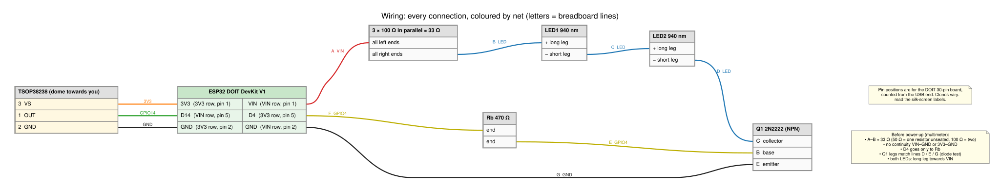
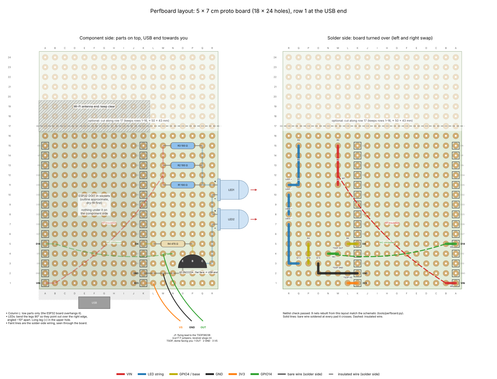

# Office AC automation: final build guide (29 Oct 2026, ESPHome)

This is the current reference for parts, wiring and the build. Superseded files (hardware.md, build-and-enclosure.md and the pre-ESPHome versions of this guide, README.md and the YAML files) are in the archive folder. The firmware is now ESPHome (esphome/office-ac.yaml), which makes "Office AC" a device in Home Assistant. README.md covers the software side; where it differs from this guide on parts or wiring, this guide wins.

## Status

| Item | Status |
| :---- | :---- |
| ESP32 boards (2 x DOIT 30-pin) | in hand |
| Other parts (see *Parts* below) | in hand |
| Transistor | 2N2222A (from a multipack), pinout confirmed E-B-C by diode test (see below) |
| LED stage | **Working on the breadboard (3 Nov 2026).** All power-off checks passed (A-B 36 ohm, base resistor 475 ohm, VIN-GND about 1.6 kohm). Loopback frames received; the AC responds from the mounting position; transistor stays cold |
| Perfboard | **Soldered and commissioned (5 Nov 2026).** ESP32 in its sockets, Home Assistant controls the AC, receiver follows the real remote, physical remote still works |
| Enclosure | **Modelled (12 Nov 2026), not printed yet.** Parametric build123d box in `enclosure/`: board on corner standoffs, LED window, USB slot, receiver hole in the lid. Check the measurements in enclosure/README.md and print fit_test.stl first |
| Solder | own reel: Sn-0.7Cu, 2% flux, 1 mm |
| Tools | own: soldering iron, multimeter, drill, side cutters |

## Parts

Typical UK prices (late 2026, inc VAT, before postage). They are ranges to budget with, not quotes; check current prices before buying.

| Qty | Item | Typical price |
| :---- | :---- | :---- |
| 1-2 | ESP32 WROOM-32 dev board, DOIT DevKit V1 style, 30-pin (a spare is handy) | £4-£10 each |
| 1 | TSOP38238 38 kHz IR receiver | £1-£2 |
| 2+ | 5 mm 940 nm IR LED (packs of 10-25 are the best value) | £2-£8 per pack |
| 1 | NPN transistor, 2N2222A / PN2222A, TO-92 (see options below) | £1-£3 for 5-10 |
| 3 | 100 ohm resistor, 1/4 W | £1-£2 per pack |
| 1 | 470 ohm resistor, 1/4 W | £1-£2 per pack |
| 1 set | Female 2.54 mm header strips: 15 holes per side (10-pin + 5-pin end to end works) | £1-£3 |
| 1 | Proto PCB 5 x 7 cm (2.54 mm pitch, 1.6 mm, 18 x 24 pads, pads not connected) | £3-£6 for a pack |
| 2 | Mini breadboard (170 points), for testing before soldering | £1-£2 each |
| 1 set | Jumper wires: male-male, female-male, female-female | £2-£6 |
| 1 | USB-A to micro-USB data cable (check your board's connector) | £2-£4 |
| 1 | Enclosure (project box, or 3D-printed) | £3-£8 |

Expect roughly **£25-£50** in total, depending on pack sizes and postage. A mixed resistor kit (£5-£10) is better value if you have none.

Suggested stores:

- **The Pi Hut, Pimoroni**: hobby parts, small packs, reliable stock information.
- **CPC (Farnell), RS, Rapid Electronics**: distributors; cheapest for transistors and resistors, but check minimum order and delivery charges.
- **Amazon, eBay**: multipacks and ESP32 boards from UK sellers; check the listing names the exact part.
- **AliExpress**: cheapest for ESP32 boards and LEDs, but delivery takes weeks.

## Transistor options (NPN, \~65 mA switching, TO-92)

- PN2222A / 2N2222A (plastic, usually emitter-base-collector). Available from the distributors above in packs of 5-10.
- Any 2N2222 / 2N2222A you already own. Metal can (TO-18) and plastic types have different pin orders, and "P2N2222A" has emitter and collector swapped. Check the datasheet.
- 2N3904 or S8050 (same emitter-base-collector order as PN2222), or BC337 (usually collector-base-emitter, the mirror of PN2222's emitter-base-collector). Mixed transistor multipacks often include PNP parts (2N2907, 2N3906, BC327), which will not work here.

Always confirm the pinout with the multimeter diode test before wiring: the base conducts to both other legs at about 0.6-0.7 V and reads open the other way; the emitter is usually the leg that reads slightly higher.

**Confirmed for the parts in hand (3 Nov 2026):** marked "2N 2222 A331" (2N2222A; 331 is a batch/date code). Flat face towards you, legs down, left to right: **E-B-C**. Red on the middle leg read about 0.70 V to the right leg and slightly higher to the left; black on the middle read OL to both. On the breadboard: left leg (E) to line G, middle (B) to line E, right (C) to line D. Use only the 2N2222A parts from the multipack and keep the rest separate.

## Wiring (DOIT 30-pin board; matches esphome/office-ac.yaml: LED on GPIO4, receiver on GPIO14)

Receiver (permanent: it lets Home Assistant follow presses on the real remote):

- TSOP38238 pin 1 (OUT) to GPIO14, pin 2 to GND, pin 3 to **3V3** (not 5 V: ESP32 pins are not 5 V tolerant). Check the pin order on your part's datasheet before powering.

IR LED stage (as built on the breadboard, 2 Nov 2026):

- **VIN** (about 5 V when USB powered) \-\> three 100 ohm resistors in parallel (about 33 ohm) \-\> LED1 anode  
- LED1 cathode \-\> LED2 anode (two LEDs in series: twice the light for the same current)  
- LED2 cathode \-\> transistor collector (right leg, flat face towards you)  
- transistor emitter (left leg) \-\> GND  
- GPIO4 \-\> 470 ohm \-\> transistor base (middle leg)

Expected currents: LED about 65 mA at VIN 5 V (about 57 mA at 4.7 V), inside the LEDs' 100 mA continuous / 1 A pulsed rating; about 0.05 W per resistor; base about 5.5 mA.

Diagrams (regenerate with `python tools/diagrams.py`):

- `docs/diagrams/schematic.svg`: full circuit, values and currents  
- `docs/diagrams/wiring.svg`: every wire coloured by net, with breadboard lines A-G and DOIT pin positions  
- `docs/diagrams/system.svg`: Home Assistant, ESP32, IR and the unit  
- `docs/diagrams/build-status.svg`: build order and what is done  
- `docs/diagrams/perfboard.svg`: hole-by-hole board layout, component and solder sides (see below)

## Perfboard layout (one board, drawn 3 Nov 2026)

Holes are named by column A-R (across the 5 cm side) and row 1-24 (along the 7 cm side), with row 1 at the USB end. On the component side, with the USB end towards you, column A is on the left. **When you turn the board over to solder, left and right swap**, so work from the solder-side view. The layout lives in `tools/perfboard.py`; it rebuilds the circuit from the hole positions and refuses to draw if any net differs from the schematic.

Why this arrangement: the ESP32 sits in the bottom-left corner so the USB socket reaches the board edge and everything else shares one 7-column strip (L-R). Nothing goes under the ESP32 on the component side, and its Wi-Fi antenna end is clear (it overhangs if you cut the board at row 17, which is good for Wi-Fi). The receiver is on a flying lead, so the box only has to face the LEDs at the AC; the receiver can poke out of any hole facing the room.

**Where the parts go (component side)**

| Part | Holes | Notes |
| :---- | :---- | :---- |
| ESP32 sockets | A1-A15 (VIN row), K1-K15 (3V3 row) | 10-pin + 5-pin strips end to end; row 1 is the USB end |
| R1, R2, R3 (100 ohm) | M11-Q11, M13-Q13, M15-Q15 | Lying flat, 4 holes apart |
| R4 (470 ohm) | L5-P5 | Lying flat. Column L must stay low: the ESP32 board overhangs it |
| Q1 2N2222A | E O3, B P3, C Q3 | Flat face towards the USB end (the way you diode-tested it: E-B-C left to right) |
| LED2 | + R8, - R7 | Long leg (+) in the upper hole. Bend 90 degrees so it points out over the right edge |
| LED1 | + R11, - R10 | As LED2; angle the two about 10 degrees apart |
| Receiver lead (J1) | VS L1, GND M2, OUT M4 | Three F-F jumpers cut to length; the TSOP38238 plugs into the female ends (dome facing you: OUT, GND, VS) |

**Solder-side wiring**

| Net | Bare wire, soldered at each pad (part legs or resistor offcuts) | Insulated wire |
| :---- | :---- | :---- |
| VIN | A1-B1; M11-M15 (bus for R1-R3) | W1: B1 to M12 |
| LED+ | R11-Q11-Q15 (bus for R1-R3) | |
| LED1- to LED2+ | R8-R9-R10 | |
| Collector | Q3-R3-R7 | |
| Base | P3-P4-P5 | |
| GPIO4 | K5-L5 | |
| GND | K2-L2-O2-O3 | |
| 3V3 | K1-L1 | |
| GPIO14 | A5-B5; M4-N4 | W2: B5 to N4 |

**Order of work**

1. **Dry-fit.** Plug the sockets onto the ESP32 and sit it on the board in A1-A15 / K1-K15 with the USB end at row 1. Check the USB plug clears the edge. If you want it smaller, cut along row 17 (score both sides with a knife and snap, or use a hacksaw). Do this outside or over a damp cloth, because glass-fibre dust is an irritant. That leaves about 50 x 43 mm.
2. **Sockets.** With the ESP32 still plugged in to hold the spacing, solder the end pins of each strip. Check the strips sit flat and straight, then remove the ESP32 and solder the rest.
3. **Low parts first.** Fit R4 and R1-R3, then Q1 (leave about 5 mm of leg, and heat each leg for 2-3 s at most), then the LEDs. Before trimming any leg, check whether it can be bent along the underside to form its own trace, for example R3's legs along columns M and Q make most of the two resistor buses.
4. **Bare traces**, using leg offcuts, then the insulated links W1 and W2 last. Lay them flat and strip about 3 mm at each end.
5. **Receiver lead.** Cut three F-F jumpers to about 10-15 cm, strip and tin the cut ends, and solder them to L1 (VS), M2 (GND) and M4 (OUT). Use colours that make the pin order obvious.
6. **Checks with the ESP32 out of its sockets and no power.** Resistance M12-Q12 is about 33 ohm, and L5-P5 is about 470 ohm. Continuity A1-M12 (VIN), K2-O3 (GND), A5-M4 (GPIO14) and K1-L1 (3V3) should beep. Neighbouring pads on different nets must not beep: K1-K2, L1-L2, A1-A2 and every pair of adjacent socket pins. In diode mode, red on P3 reads about 0.7 V to O3 and Q3, red on R8 reads about 0.97 V to R7, and red on R11 reads the same to R10. Then plug the ESP32 in, power up and repeat the loopback test.

**Enclosure size.** The board plus the ESP32 in sockets stands about 25 mm tall including the solder joints underneath. The LEDs stick out about 10 mm past the right edge, and the ESP32's antenna end overhangs row 16 by a few millimetres. An inside space of about 65 x 55 x 30 mm is enough. Put the LED holes in the wall the right-hand edge faces, add a small hole facing the room for the receiver, and cut a USB slot at the row-1 end.

## Build order

1. Install ESPHome: the *ESPHome Device Builder* add-on in Home Assistant, or `pip install esphome` on your PC (README section 2). Use 2.4 GHz Wi-Fi.
2. Fill in secrets.yaml from esphome/secrets.yaml.example (Wi-Fi, fallback hotspot password, API key).
3. **Receiver test** (needs only the ESP32 and receiver, no transistor yet): plug female jumper ends onto the ESP32's header pins and the male ends into a mini breadboard holding the receiver. Uncomment `dump: all` in office-ac.yaml and flash over USB (README section 3). Open the logs and press buttons on the real remote from about 30 cm. A decoded Mitsubishi frame in the log confirms the receiver and the protocol.
4. Add the device in Home Assistant: Settings -> Devices & services -> *Discovered* ESPHome -> *Configure*, with the same API key. Press a button on the real remote: the Office AC thermostat card should follow it.
5. **LED stage** (once the transistor arrives): build it on the second mini breadboard, check the LED flashes on a phone camera when you change the mode in Home Assistant, then test Cool / 22 C on the unit from about 2 m.
6. Set `set_fan_mode` to match the number of fan speeds on the remote, comment `dump: all` out again, and install wirelessly.
7. Solder to the proto PCB: follow *Perfboard layout* above.
8. Enclosure: drill about 5 mm holes in the wall facing the AC unit for the two LEDs (the board's right-hand edge sits against it), and one about 5 mm hole facing into the room for the receiver on its lead. Cut a slot for the USB cable at the row-1 end and mount the board on stick-on pads or the box's PCB guides.
9. Give the board a DHCP reservation. Home Assistant finds it by name, but a fixed address makes troubleshooting easier.

## First-build things to watch

- The ESPHome config passes validation on ESPHome 2026.10.1 but has not been compiled yet. The first compile downloads the ESP-IDF toolchain and takes several minutes; later ones are quick.
- Flashing from the add-on with *Plug into this computer* needs Chrome or Edge and the dashboard opened over HTTPS.
- Some DOIT-style boards need the BOOT button held while "Connecting..." shows during upload.
- A CP2102 or CH340 USB chip may need a driver on Windows. Board listings do not always say which.
- Confirm the board's USB connector is micro-USB and matches your cable.
- Before first power-up, use continuity mode: no beep between 3V3 and GND, or VIN and GND, and none between neighbouring socket pins (solder bridges).
- Solder: Sn-0.7Cu melts at 227 C, so run the tip hot (typically 330-370 C) and feed sparingly with 1 mm wire.

## Not used / alternatives considered

- Arduino Nano ESP32: needs pins A3/A7 instead of 4/14, LED supply from VBUS (not VIN), and carries extra library risk on the ESP32-S3. Not chosen.  
- Wired CN105 route (README section 0): would give two-way state; not part of this build.  
- PlatformIO HTTP controller (src/controller.cpp): an alternative, but Home Assistant only sees commands, not a device. Kept as a fallback with the capture firmware.
